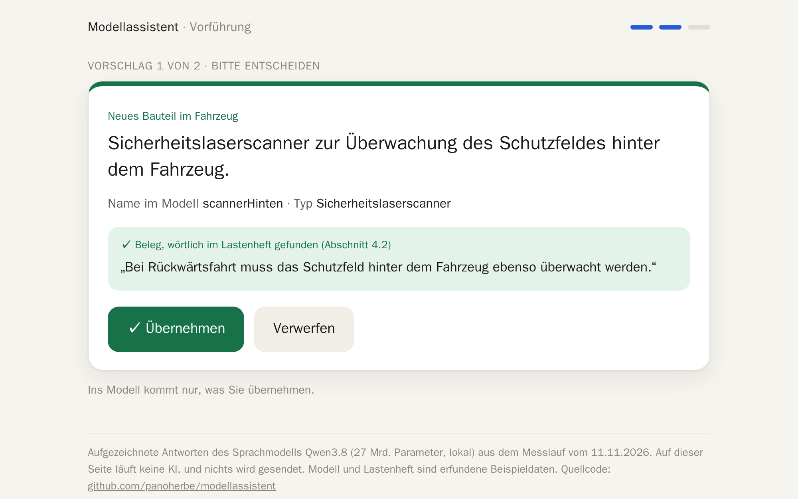
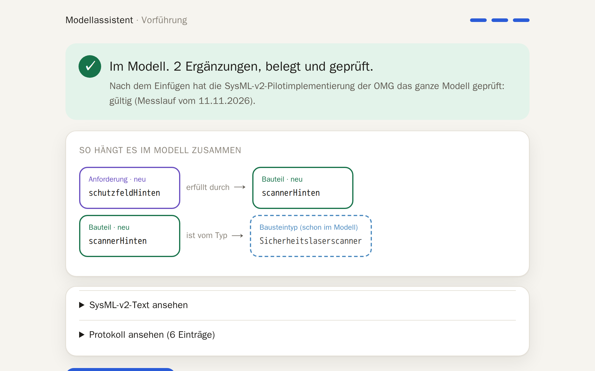

# Modellassistent

**Aus einem Satz in Alltagssprache wird ein geprüfter Eintrag im SysML-v2-Systemmodell. Der Assistent schlägt vor und
belegt jede Ergänzung wörtlich aus dem Lastenheft; ins Modell kommt nur, was ein Mensch bestätigt. Das läuft heute,
lokal, mit einem offenen Sprachmodell und erfundenen Beispieldaten.**


Rundgang ohne Ton, mit Untertiteln, 67 s · [als Video herunterladen (MP4, 1,3 MB)](medien/rundgang.mp4) ·
aufgezeichnete Antworten aus dem Messlauf vom 11.11.2026

### ▶ Selbst ausprobieren, ohne Installation: [panoherbe.com/projekte/modellassistent](https://panoherbe.com/projekte/modellassistent)

Sie wählen einen Wunsch, entscheiden jede Ergänzung und sehen das Ergebnis im Modell, den SysML-v2-Text und das
Protokoll. Die Seite spielt die Antworten ab, die das Sprachmodell im Messlauf wirklich gegeben hat; auf ihr läuft
keine KI, und nichts wird gesendet. Die Vorführung ist eine einzige Datei:
[`vorfuehrung/modellassistent-vorfuehrung.html`](vorfuehrung/modellassistent-vorfuehrung.html).

<details><summary>Untertitel des Rundgangs als Text</summary>

| Zeit | Untertitel |
|---|---|
| 0:00 | Titel: „Ein Satz. Ein geprüfter Eintrag im Modell.“ |
| 0:05 | Ein Wunsch in Alltagssprache genügt. (Hier: ein zweiter Scanner für die Rückwärtsfahrt) |
| 0:10 | Der Assistent sucht im Lastenheft und prüft, ob der Wunsch eindeutig ist. |
| 0:13 | Vorschlag 1: ein neues Bauteil im Fahrzeug. (mit wörtlichem Beleg aus dem Lastenheft) |
| 0:17 | Der Beleg steht wörtlich so im Lastenheft. Das prüft das Programm, nicht das Sprachmodell. |
| 0:22 | Sie entscheiden: übernehmen oder verwerfen. |
| 0:23 | Vorschlag 2: die passende Anforderung, verknüpft mit dem neuen Bauteil. |
| 0:28 | Erst jetzt kommt es ins Modell. Die OMG-Pilotimplementierung prüft das ganze Modell: gültig. |
| 0:34 | So hängt es zusammen: Anforderung, erfüllt durch das neue Bauteil. |
| 0:38 | Der SysML-v2-Text entsteht aus Vorlagen, nie frei vom Sprachmodell. |
| 0:42 | Jeder Schritt steht im Protokoll; spätere Änderungen fallen auf. |
| 0:47 | Und wenn der Wunsch ungenau ist? |
| 0:50 | Der Assistent rät nicht. Er fragt nach, und das Modell bleibt unverändert. |
| 0:55 | Karte „Was der Messlauf zeigt“: Rückfrage 7 von 7, belegt 22 von 22, gültig 16 von 16, Daten bleiben im Haus |
| 1:02 | Karte „Selbst ausprobieren“: panoherbe.com/projekte/modellassistent |

</details>

## So arbeitet man damit

| Schritt | Was Sie tun | Was der Assistent tut |
|---|---|---|
| 1 Beschreiben | den Wunsch hinschreiben, wie man ihn einer Kollegin sagt | sucht im Lastenheft und im Modell; fehlt eine Angabe, fragt er nach, statt zu raten |
| 2 Prüfen | jede Ergänzung übernehmen, ändern oder verwerfen | zeigt sie mit Beleg; „wörtlich gefunden“ heißt: das Zitat steht so im Lastenheft, geprüft vom Programm |
| 3 Übernehmen | einmal „Ins Modell übernehmen“ | schreibt SysML v2 aus Vorlagen, lässt das ganze Modell von der OMG-Pilotimplementierung prüfen, hält jeden Schritt im Protokoll fest |

| Vorschlag prüfen | Im Modell |
|---|---|
|  |  |

## Was gemessen ist

Messlauf vom 11.11.2026: 24 selbst geschriebene Aufgaben zu erfundenen Beispieldaten, je ein Durchgang, Temperatur 0.

| Was | Ergebnis |
|---|---|
| Fehlt eine Angabe oder widerspricht der Wunsch dem Lastenheft, fragt der Assistent nach | 7 von 7 |
| Ein klarer Wunsch wird zu einem Vorschlag | 16 von 17 (einmal fragte er unnötig nach) |
| Die Ergänzung steht auf der richtigen Ebene (Anforderung, Funktion, Baustein, Bauteil) | 16 von 17 |
| Jede Ergänzung hat einen Beleg; das Zitat steht wörtlich im Lastenheft | 22 von 22 |
| Ergänzungen ohne Prüffehler | 22 von 22 |
| Das ganze Modell ist danach gültig (OMG-Pilotimplementierung) | 16 von 16 |
| Die erwartete Verknüpfung zu einem vorhandenen Element ist gesetzt | 7 von 11 |
| Ein zweiter Lauf mit denselben Einstellungen bringt dasselbe Ergebnis | 24 von 24 |
| Dauer je Wunsch (Median, Grafikkarte RTX 3060 mit 12 GB) | 50 s |

Alle acht Läufe, auch die schlechteren, und die Wahl der Modelle: [`nachweis/PROTOKOLL.md`](nachweis/PROTOKOLL.md).

## Welche KI läuft da?

| | Was es ist | Wofür |
|---|---|---|
| **Qwen3.8** (27 Mrd. Parameter) | offenes Sprachmodell der neuesten Generation, Apache 2.0, läuft lokal auf einer Grafikkarte, ohne Cloud | versteht den Wunsch, fragt bei Unklarem nach und formuliert den Vorschlag in einer festen Struktur |
| **EmbeddingGemma 2** | kleines offenes Suchmodell von Google, Apache 2.0; kein Chatmodell | findet zu einem Wunsch die passenden Absätze im Lastenheft, damit das Sprachmodell nur mit echten Quellen arbeitet |
| **OMG-Pilotimplementierung** | die Referenzsoftware zu SysML v2 der OMG (jupyter-sysml-kernel 0.63.1) | prüft das ganze Modell nach jeder Übernahme; ist es ungültig, entsteht kein neuer Stand |

Beide Modelle sind austauschbar (eine Einstellung). Was ins Modell geht, entscheidet nie das Sprachmodell: Kennungen
vergibt das Programm, der SysML-Text entsteht aus Vorlagen, die Belege prüft das Programm Wort für Wort.

## Was der Prototyp noch nicht ist

Modell und Lastenheft sind erfunden (ein autonomes Flurförderfahrzeug). Der Assistent legt neue Elemente an, ändert aber
keine vorhandenen; Anmeldung und Rollen fehlen; die Messaufgaben sind selbst geschrieben und dienten auch zum Verbessern
der Anweisungen. Ein Vorschlag dauert mit dem großen Modell auf einer Grafikkarte mit 12 GB rund 50 Sekunden.

## Aufbau dieses Repositorys

| Ordner | Inhalt |
|---|---|
| [`vorfuehrung/`](vorfuehrung/) | die Vorführung als eine Datei und das Skript, das sie aus einem Messlauf baut |
| [`app/`](app/) | die Anwendung: Weboberfläche, Klärung, Vorschlag, Prüfregeln, SysML-Erzeugung, Protokoll |
| [`pruefer/`](pruefer/) | Prüfdienst mit der OMG-Pilotimplementierung |
| [`beispiel/`](beispiel/) | erfundene Beispieldaten: Systemmodell (`ftf.sysml`) und Lastenheft |
| [`eval/`](eval/) | die 24 Messaufgaben und das Messprogramm |
| [`nachweis/`](nachweis/) | Ergebnisse aller Messläufe und Testläufe, Messprotokoll |
| [`tests/`](tests/) | automatische Tests ohne Sprachmodell (19 bestanden am 13.11.2026) |
| [`medien/`](medien/) | Rundgang und Bilder; `medien/anwendung/` zeigt die Anwendung mit echtem Sprachmodell (Aufnahme vom 11.11.2026) |

## In zwei Minuten selbst starten

Ohne Installation: die [Vorführung](https://panoherbe.com/projekte/modellassistent). Mit Docker und Compose die Tests
und die Anwendung mit echtem Sprachmodell (NVIDIA-Grafikkarte mit mindestens 12 GB; gemessen: RTX 3060, 12 GB):

```bash
docker volume create ollama-modelle                # einmal: Speicher für die Modelle
docker compose run --rm test                       # Tests ohne Sprachmodell, wenige Sekunden
docker compose up -d
docker compose exec ollama ollama pull qwen3.8:27b
docker compose exec ollama ollama pull embeddinggemma-2
# Oberfläche: http://127.0.0.1:8431
docker compose run --rm app python -m eval.messen --ausgabe nachweis/neu   # eigener Messlauf
python vorfuehrung/baue.py nachweis/neu                                    # Vorführung aus dem eigenen Lauf
```

## Technik (für Fachleute)

| Baustein | Umsetzung |
|---|---|
| Systemmodell | synthetisches SysML-v2-Modell in RFLP-Struktur (`beispiel/ftf.sysml`): 7 Anforderungen, 7 Funktionen, 8 logische Bausteine, das Fahrzeug mit 7 Teilen, 14 Beziehungen (*satisfy*, *allocate*) |
| Wissensquelle | synthetisches Lastenheft mit 20 Absätzen, je mit Kennung `LH-x.y` (`beispiel/lastenheft-ftf.md`) |
| Sprachmodell | `qwen3.8:27b` über Ollama 0.40.16 (austauschbar über `OLLAMA_URL`), Temperatur 0, Denkmodus aus |
| Abruf | Ähnlichkeitssuche mit `embeddinggemma-2` (Anfrage- und Dokumentformat nach Hersteller), sechs Absätze je Eingabe; im Vergleich mit drei Größen von `qwen3-embedding` das beste (`eval/abruf.py`) |
| Klärung | erst prüft das Sprachmodell, ob die Eingabe reicht (Zielwert fehlt, Widerspruch zu einer Quelle, unklar); dann Rückfrage statt Vorschlag |
| Vorschlag | Antwort nur in fester Struktur (JSON-Schema: Ebene, Name, Beschreibung, Typ, Beziehungen, Quellen mit Zitat); Kennungen vergibt das Programm |
| Prüfung | Ebene, Name, Doppelungen, Typ eines Teils, zulässige Beziehungen (R *satisfy* P, F *allocate* P), Quelle aus dem Kontext und Zitat wörtlich belegt; Fehler sperren die unveränderte Übernahme |
| SysML v2 | Text nur aus Vorlagen, an festen Stellen eingefügt; das ganze Modell prüft der Jupyter-Kernel der OMG-Pilotimplementierung (`pruefer/`); ist es ungültig, entsteht kein neuer Modellstand |
| Protokoll | Einträge nur anhängbar, jede spätere Änderung fällt auf (Hash-Kette); je Schritt Sprachmodell, Prompt-Version, Quellen mit Stand, Befunde, Entscheidung vorher/nachher |
| Übergabe | SysML-v2-Text und JSON (`/api/anfrage/{id}/export`), REST mit OpenAPI (`/docs`) |

## Lizenz

AGPL-3.0. Sprachmodell Qwen3.8 und Suchmodell EmbeddingGemma 2 (beide Apache 2.0), OMG SysML v2 Pilot Implementation
(EPL-2.0).

Panagiotis Herbe · [panoherbe.com](https://panoherbe.com)
