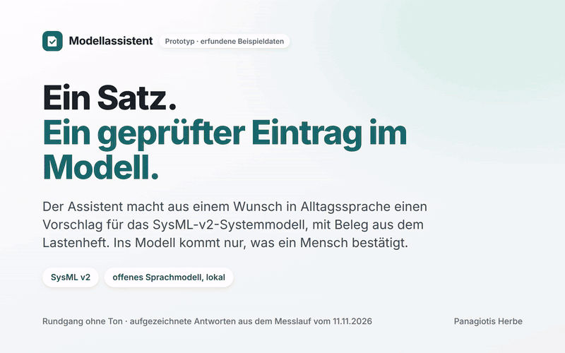
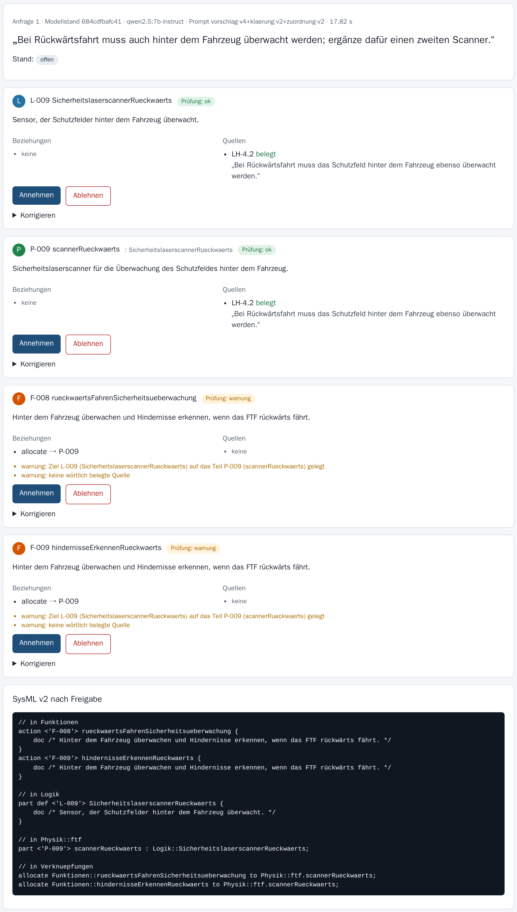
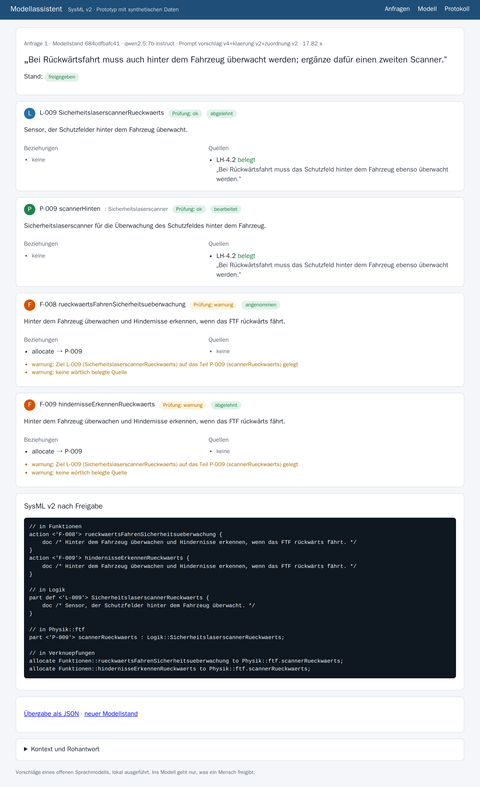

# Modellassistent

**Änderungswünsche in Alltagssprache werden zu geprüften Ergänzungen eines Systemmodells (SysML v2), jede mit Beleg
aus dem Lastenheft. Der Mensch entscheidet jede Ergänzung; ins Modell kommt nur, was er bestätigt, und die offizielle
SysML-v2-Software der OMG prüft das ganze Modell. Das läuft heute, lokal, mit dem offenen Sprachmodell Qwen3.8 und
Beispieldaten.**



Rundgang ohne Ton, 57 s: [als Video herunterladen (MP4)](medien/rundgang.mp4)

## So arbeitet man damit

**Kurz:** drei Schritte, eine Handlung je Bildschirm.

| Schritt | Was Sie tun | Was der Assistent tut |
|---|---|---|
| 1 Beschreiben | den Wunsch hinschreiben, wie man ihn einer Kollegin sagt | liest Modell und Lastenheft; fehlt ein Wert, fragt er nach, statt zu raten |
| 2 Prüfen | je Ergänzung übernehmen, ändern oder verwerfen | zeigt jede Ergänzung mit Beleg; „wörtlich gefunden“ heißt: das Zitat steht so im Lastenheft |
| 3 Übernehmen | einmal „Ins Modell übernehmen“ | schreibt SysML v2 aus Vorlagen, lässt das ganze Modell von der OMG-Software prüfen, hält jeden Schritt im Protokoll fest |

| Vorschlag prüfen | Übernommen |
|---|---|
|  |  |

## Was gemessen ist

**Kurz:** Wo eine Angabe fehlt, fragt er nach (7 von 7); alle 22 Ergänzungen sind belegt und fehlerfrei; das Modell blieb jedes Mal gültig. Messlauf vom 11.11.2026, 24 selbst geschriebene Aufgaben, Beispieldaten.

| Was | Ergebnis |
|---|---|
| Fehlt ein Wert oder widerspricht der Wunsch dem Lastenheft, fragt der Assistent nach | 7 von 7 |
| Ein klarer Wunsch wird zu einem Vorschlag | 16 von 17 (einmal fragte er unnötig nach) |
| Die Ergänzung steht auf der richtigen Ebene (Anforderung, Funktion, Bauteil) | 16 von 17 |
| Jede Ergänzung hat einen Beleg, das Zitat steht wörtlich im Lastenheft | 22 von 22 |
| Ergänzungen ohne Prüffehler | 22 von 22 |
| Das ganze Modell ist danach gültig (OMG-Software) | 16 von 16 |
| Der passende Lastenheft-Absatz ist unter den gefundenen | 22 von 22 |
| Die erwartete Verknüpfung zu einem vorhandenen Element ist gesetzt | 7 von 11 |
| Dauer je Eingabe (Median, RTX 3060 mit 12 GB) | 45 s |

Alle sieben Läufe, auch die schlechteren, und die Wahl der Modelle: [`nachweis/PROTOKOLL.md`](nachweis/PROTOKOLL.md).
Die Läufe 1 bis 6 liefen mit einem kleineren Vorgängermodell; ab Lauf 7 mit der aktuellen Generation (Qwen3.8 mit
27 Milliarden Parametern, Einbettung EmbeddingGemma 2).

## In zwei Minuten selbst prüfen

**Kurz:** ein Befehl für die Tests, einer für die Oberfläche.

Voraussetzung: Docker mit Compose. Für die Oberfläche eine NVIDIA-Grafikkarte mit 12 GB oder mehr (gemessen: RTX 3060,
12 GB; das Modell liegt dort gut zur Hälfte im Hauptspeicher, mit 20 GB ganz auf der Karte).

```bash
docker compose run --rm test                       # Tests ohne Sprachmodell, wenige Sekunden
docker volume create ollama-modelle                # einmal: Speicher für die Modelle
docker compose up -d
docker compose exec ollama ollama pull qwen3.8:27b
docker compose exec ollama ollama pull embeddinggemma-2
# Oberfläche: http://127.0.0.1:8431
docker compose run --rm app python -m eval.messen --ausgabe nachweis/neu   # eigener Messlauf
```

## Was der Prototyp nicht ist

**Kurz:** ein Prototyp mit erfundenen Daten, kein Produkt.

Modell und Lastenheft sind erfunden (ein autonomes Flurförderfahrzeug). Der Assistent legt neue Elemente an, ändert
aber keine vorhandenen; Anmeldung und Rollen fehlen; die Messaufgaben sind selbst geschrieben und dienten auch zum
Verbessern der Anweisungen. Ein Vorschlag dauert mit dem großen Modell auf einer 12-GB-Karte rund 45 Sekunden, höchstens gut eine Minute.

## Technik (für Fachleute)

| Baustein | Umsetzung |
|---|---|
| Systemmodell | synthetisches SysML-v2-Modell in RFLP-Struktur (`modell/ftf.sysml`): 7 Anforderungen, 7 Funktionen, 8 logische Bausteine, das Fahrzeug mit 7 Teilen, 14 Beziehungen (*satisfy*, *allocate*) |
| Wissensquelle | synthetisches Lastenheft mit 20 Absätzen, je mit Kennung `LH-x.y` (`wissen/`) |
| Sprachmodell | `qwen3.8:27b` über Ollama 0.40.16 (austauschbar über `OLLAMA_URL`), Temperatur 0, Denkmodus aus |
| Abruf | Ähnlichkeitssuche mit `embeddinggemma-2` (Anfrage- und Dokumentformat nach Hersteller), sechs Absätze je Eingabe; im Vergleich mit drei Größen von `qwen3-embedding` das beste (`eval/abruf.py`) |
| Klärung | erst prüft das Sprachmodell, ob die Eingabe reicht (Zielwert fehlt, Widerspruch zu einer Quelle, unklar); dann Rückfrage statt Vorschlag |
| Vorschlag | Antwort nur in fester Struktur (JSON-Schema: Ebene, Name, Beschreibung, Typ, Beziehungen, Quellen mit Zitat); Kennungen vergibt das Programm |
| Prüfung | Ebene, Name, Doppelungen, Typ eines Teils, zulässige Beziehungen (R *satisfy* P, F *allocate* P), Quelle aus dem Kontext und Zitat wörtlich belegt; Fehler sperren die unveränderte Übernahme |
| SysML v2 | Text nur aus Vorlagen, an festen Stellen eingefügt; das ganze Modell prüft der Jupyter-Kernel der OMG-Pilotimplementierung (`pruefer/`); ist es ungültig, entsteht kein neuer Modellstand |
| Protokoll | Einträge nur anhängbar, jede spätere Änderung fällt auf (Hash-Kette); je Schritt Sprachmodell, Prompt-Version, Quellen mit Stand, Befunde, Entscheidung vorher/nachher |
| Übergabe | SysML-v2-Text und JSON (`/api/anfrage/{id}/export`), REST mit OpenAPI (`/docs`) |

## Lizenz

AGPL-3.0. Sprachmodell Qwen3.8 und Einbettung EmbeddingGemma 2 (beide Apache 2.0), OMG SysML v2 Pilot Implementation
(EPL-2.0). Auftraggeber erhalten im Auftrag die vertraglich vereinbarten Rechte.

Panagiotis Herbe · [panoherbe.com](https://panoherbe.com)
